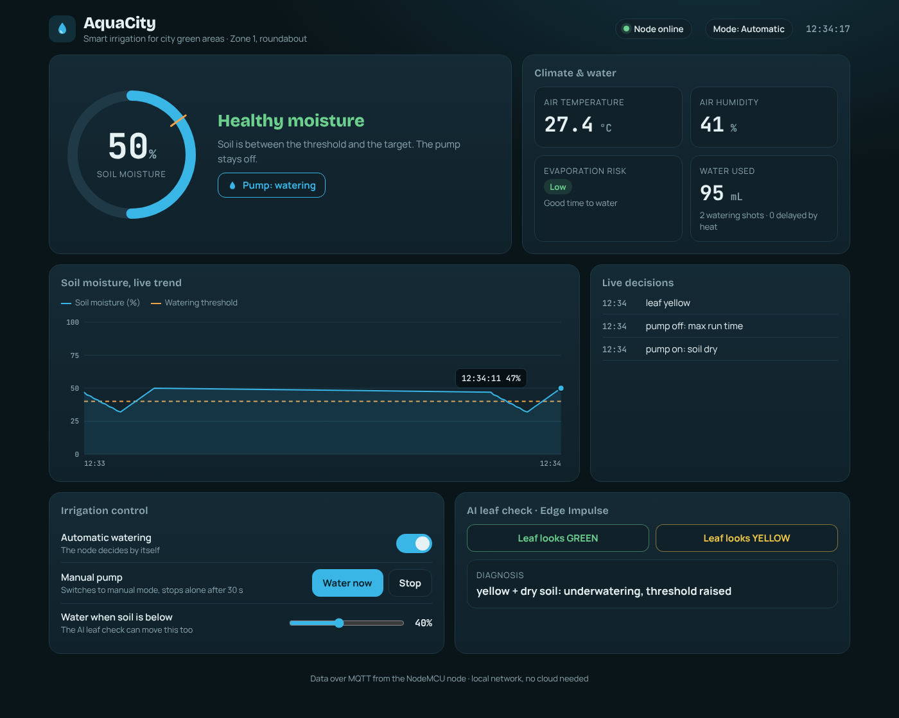
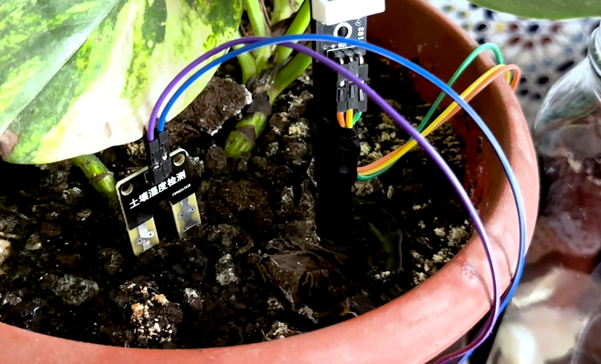
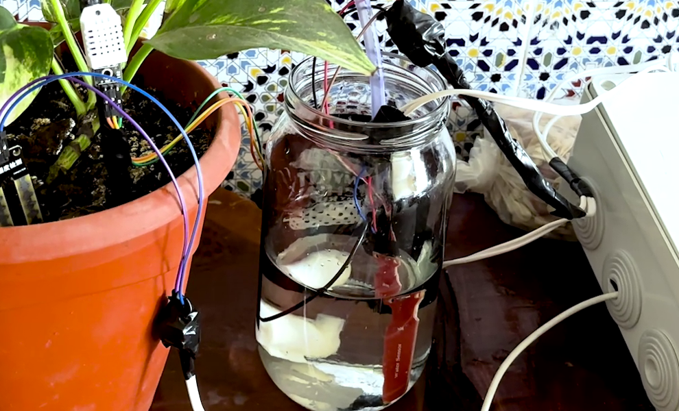

# AquaCity: smart irrigation for city green areas

**Qubit, FP Larache · Smart Cities Hackathon Laayoune 2026 (ASCIC 2026)**

AquaCity waters a city green area only when it needs it. A NodeMCU node in the soil measures
moisture, air temperature and humidity, runs the pump by itself, and streams everything over MQTT
to a live dashboard on the local network. No cloud is needed, and irrigation keeps working without Wi-Fi.



| Soil and air sensors | Water tank and level sensor |
| --- | --- |
|  |  |

## How it works

- **Waters only when the soil is dry.** The pump starts below the threshold (35 % by default) and
  stops at the target (threshold + 20 %). One automatic shot lasts 5 s at most, then the node waits
  30 s for the water to spread.
- **Waits out hot, dry air.** Above 30 °C with humidity under 30 %, most of the water would evaporate,
  so watering is delayed. If the soil drops below 15 %, it waters anyway so the plant survives.
- **Tank safety.** With a tank sensor fitted, the pump never runs when the tank is below 15 %.
- **AI leaf check (Edge Impulse).** A green / yellow leaf result is combined with the soil reading:
  - yellow + dry soil: underwatering, threshold raised
  - yellow + wet soil: overwatering, threshold lowered
  - yellow + normal soil: check nutrients or disease
- **Manual control.** From the dashboard you can switch to manual, run the pump (it stops by itself
  after 30 s), or move the threshold.
- **On-device LCD.** Shows temperature, humidity, soil moisture and the pump state.

## Hardware

| Part | NodeMCU pin |
| --- | --- |
| DHT22 (air temperature / humidity) | D2 |
| Soil moisture sensor (fork probe) | A0 |
| Relay for the water pump | D5 |
| 16x2 I2C LCD (0x27) | SDA D3, SCL D1 |
| Tank probe, optional (`USE_TANK_PROBE 1`) | D6 |
| ADS1115, optional (`USE_ADS1115 1`) | I2C, soil on A0, tank on A1 |

## Repository

```
firmware/smart_farm_esp8266/   ESP8266 sketch (Arduino IDE)
node-red/aquacity-dashboard-flow.json   AquaCity dashboard (served at /farm)
node-red/node-red-flow.json             first Node-RED Dashboard version
docs/                          screenshots and photos
```

## Setup

1. **MQTT broker.** Install [Mosquitto](https://mosquitto.org/download/) on the laptop and run it on
   port 1883 with a user for the node.
2. **Firmware.**
   - In the Arduino IDE, install the ESP8266 board package and the libraries `PubSubClient`,
     `DHT sensor library`, `Adafruit Unified Sensor`, `LiquidCrystal I2C`
     (and `Adafruit ADS1X15` if you use the ADS1115).
   - Copy `firmware/smart_farm_esp8266/secrets.example.h` to `secrets.h` in the same folder and fill
     in your Wi-Fi and MQTT settings. `secrets.h` is ignored by git.
   - Calibrate `SOIL_DRY_RAW` / `SOIL_WET_RAW` from the raw values in the Serial Monitor (115200 baud),
     then upload to the NodeMCU.
3. **Dashboard.** In Node-RED, import `node-red/aquacity-dashboard-flow.json`, set the MQTT broker
   user and password in the broker node, deploy, and open `http://localhost:1880/farm`.

## MQTT topics

All topics start with `iotfrontier/`.

| Topic | Direction | Content |
| --- | --- | --- |
| `temperature`, `humidity`, `soil`, `waterlevel` | node → dashboard | readings |
| `pump/state`, `mode/state`, `threshold/state` | node → dashboard | current state (retained) |
| `water_used_ml`, `event`, `diagnosis`, `status` | node → dashboard | water used, decisions, AI diagnosis, online / offline |
| `pump` (`ON` / `OFF`), `mode` (`AUTO` / `MANUAL`), `threshold` (10–80) | dashboard → node | commands |
| `leaf` (`green` / `yellow`) | AI → node | leaf check result |

## Status

- **Done:** sensing, auto watering, tank safety, LCD, MQTT, dashboard
- **Beta:** green / yellow AI leaf check (98 % and 91 % in tests)
- **In progress:** city map, LoRa, solar power
